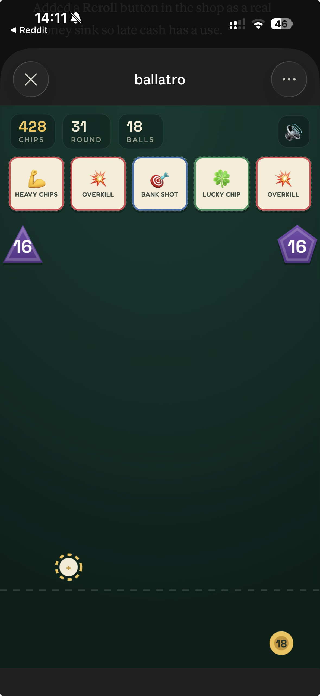

# 🎱 BALLATRO

A single-file mobile web game that mashes **Holedown**'s elongated capsule ball physics with **Balatro**'s joker-card economy. Break the chips, bank the money, stack five jokers, and survive each table's six rounds plus boss overtime.

**▶ Play:** `https://USERNAME.github.io/ballatro/` *(live once GitHub Pages is enabled — see below)*

## How to play

- **Drag** anywhere to aim, release to fire elongated capsules that accelerate out of the launcher.
- **Tap** mid-flight to fast-forward the bounce.
- Clear the chips before they cross the dashed danger line. **Chips are supported by anchors** — the top row (newest, attached to the ceiling) and the boss (if alive). Break a chip holding up a cluster and the rest **fall off the board**, adding their starting HP to Score while retaining their normal Cash payout. Falling cut chips demolish chips and bosses below them, dealing 25% of their HP as damage (max 4 hits per faller). This is the core skill: aim for the load-bearing block, not the stack above it.
- The **shop** opens after rounds 2 and 4, then again after the boss. You hold five jokers positioned at the bottom of the screen in the thumb zone — tap any joker to see its effect. Every shop sells **Ball Packs** for permanent +1 ball ($10 Cash first, +$6 each after).
- Every table has six normal rounds, followed by a **boss brick** and overtime pressure rows until it falls. Its armor floors weak hits at 1 damage, so you need damage jokers to punch through before it descends onto you.
- Breaking or cutting chips retains its normal **Cash** payout and also adds the chip's starting HP to **Score**; actual boss damage adds Score. Three automatic goals (Easy, Medium, Hard) appear at the bottom alongside your jokers with on-board ⌖/row markers; completed goals stack their score multipliers and award separate Cash bounties. Quotas have been raised and chip HP softened to balance score builds against damage builds.
- Each volley displays a non-blocking score banner. Tap the score stat to reveal a 'Last volley' breakdown showing direct, cascade, and boss score, completed goals, the stacked multiplier, and Cash bounties.

## Tables & Win Condition

Progress through eight named casino floors, each ending with a boss encounter. Beat **The House** (Table 8) to win the run. Clear a table, bank your earnings in the cash-out ceremony, and advance to the next.

| Table | Rounds | Boss |
|---|---|---|
| Penny Slots | 1–6 + overtime | Boss 1 |
| Main Floor | 7–12 + overtime | Boss 2 |
| High Limit | 13–18 + overtime | Boss 3 |
| VIP Room | 19–24 + overtime | Boss 4 |
| Whale Tank | 25–30 + overtime | Boss 5 |
| The Vault | 31–36 + overtime | Boss 6 |
| Owner's Suite | 37–42 + overtime | Boss 7 |
| The House | 43–48 + overtime | Boss 8 |

**Win condition:** Defeat the boss and meet the table Score quota. If the boss falls short of quota, collection overtime adds full pressure rows until the quota is met or the table crushes you. You'll see a "YOU BEAT THE HOUSE" screen after Table 8 and may continue into **Overtime** (endless tables, numbered 9+) or start a fresh run.

**Cash-out ceremony:** When you clear a table, the board pauses and a staggered overlay shows your earnings: chips broken, chips cut (from cascades), crits landed, boss bonus, and a table clear bonus (scales with table difficulty). Bank it all and advance.

**Depth-meter HUD:** The top stat shows your table name and progress (`X/6` rounds), with a gold bar filling as you advance. When a boss is alive, the bar turns red and the label reads `BOSS`, showing remaining HP.

## Jokers

Five slots, 89 jokers across four rarities. Shop offers roll **55% common / 32% uncommon / 11% rare / 2% legendary** per slot. Cards marked with warning icons are double-edged.

Every joker has gameplay archetype tags (damage, balls, Cash, cascade, precision, shop, risk, or utility). Once your hand develops an identity, one shop slot is biased toward its dominant tag while keeping that slot's original rarity roll; offers remain unique.

### Rarity tiers & distribution

- **Common (40)** — Basic +1/+2 effects or narrow conditionals. Build the foundation.
- **Uncommon (30)** — ×2 conditionals, +2–3 flats, or small chains. Start synergies.
- **Rare (15)** — Build-arounds, scaling mechanics, or aggressive caps. Game-shifters.
- **Legendary (4)** — Run-defining effects that alter how you play. Rare finds.

### Representative jokers

| Joker | Effect | Rarity |
|---|---|---|
| Heavy Chips | +1 damage on every ball | Common |
| Interest | +$2 Cash per $8 held at round end (cap $16) | Common |
| Laser Sight | shows the full reflected aim path, but −25% Cash | Common |
| Extra Ball | +1 ball each launch | Uncommon |
| Midas Touch | +50% Cash from breaks | Uncommon |
| Bank Shot | +1 damage per side-wall bounce (max +3) | Uncommon |
| Glass Cannon | +3 damage, but −2 balls | Rare |
| Chain Reaction | breaks deal 1 damage to nearby chips | Rare |
| Wild Card | counts as one copy of every other joker you hold | Legendary |
| Ghost Chip | balls always pierce killed chips | Legendary |

Default aim only shows a straight direction ray — Laser Sight is the only way to preview bounces.

## Combo Counter

When you destroy 3+ chips in a single turn, a pulsing gold **COMBO ×N** appears at the top of the screen, celebrating your momentum. The number rises with each additional chip destroyed that turn. Combined with turn receipts (which show chip-break and cut counts for large turns), combos reward aggressive, synergistic play.

Support links and `CUT N` badges expose load-bearing targets. Impacts use brief hit-stop, damaged chips crack visibly, and cascades fall in a staggered sequence with rising notes. Flight automatically speeds up after 0.9 and 1.8 seconds without a productive hit, resets on impact, and fast-returns balls once the board is safely behind them; tapping still toggles manual 3× speed.

### Bank Shot & wall bounces

Bank Shot adds +1 damage per side-wall bounce (left/right walls), capped at **+3 damage per ball flight**. The ceiling no longer counts — near-vertical farming was the exploit. Each copy of Bank Shot raises the cap by 3, so two copies can add up to +6 total. Stacking is still worth building around. Toll Booth (the Cash-income cousin) keeps its own separate cap, and Kite retains its first-ceiling-hit niche.

## Boss

An armored brick occupying 5 of 7 columns arrives after round 6, leaving a threadable gap. You can position balls to get behind the boss, cut shielded rows beneath it, and ricochet off its top face for direct damage. Damage normally uses `max(1, ball_damage − armor)`; HP is `baseHp(12*num)*7`, armor is `1 + ceil(table/2)`, and the Cash reward is 20% of starting HP. The next boss and its rule are previewed in every shop.

Boss fights are no longer a breather: every second failed boss-overtime volley spawns a half-HP pressure row. Boss rules follow a visible four-table cycle:

| Modifier | Effect |
|---|---|
| THE VAULT | Damage is capped at 1 until a ball banks off two side walls |
| THE SCISSORS | Cascades forge one-hit guards that cap damage at 1 |
| LAST CALL | The final ball in each volley deals triple boss damage |
| SPLIT POT | Lit half takes ×2, dark half ×0.5; the lit side flips each hit |

Chip HP gets much tougher by rounds 5–6 and in later tables. A single launch clears only ~50–70% of a fresh row — full clears become rare, and you'll triage which blocks to target while letting the rest descend.

## Meta-Progression

Your best moments are saved. The game tracks best table reached, longest run, best earnings, and lifetime stats (total chips broken, ball launches, boss kills). On the start screen, a persistent line shows your previous run's best: *"Best: Table N · Depth M"*.

### Locked Jokers & Achievements

Fourteen rare and legendary jokers are locked behind achievements, encouraging long-term play and varied strategies:

| Joker | Rarity | Unlock Condition |
|---|---|---|
| Twins | Rare | Reach Table 2 |
| Chain | Rare | Reach Table 3 |
| Snowball | Rare | Reach Table 4 |
| Phalanx | Rare | Reach Table 5 |
| Investor | Rare | Reach Table 6 |
| Hall of Mirrors | Rare | Reach Table 7 |
| Headhunter | Rare | Defeat your first boss |
| Shatterpoint | Rare | Break a 5+ chip cascade in one turn |
| Timebomb | Rare | Launch 50 balls (lifetime) |
| Avalanche | Rare | Break 500 chips (lifetime) |
| Wild Card (leg) | Legendary | Beat Table 8 (The House) |
| Ghost Chip (leg) | Legendary | Defeat 3 bosses (lifetime) |
| Jackpot (leg) | Legendary | Bank 500 chips in a single run |
| Ouroboros (leg) | Legendary | Break 1000 chips (lifetime) |

Locked jokers don't appear in the shop until unlocked. The pool remains healthy — a core set of commons and uncommons is always available, and rares/legendaries unlock progressively as you play.

## Tech

- One `index.html`. Vanilla JS + Canvas. **No build step or bundled assets.**
- Real circle-vs-convex-polygon collision so the irregular multi-cell blocks bounce off their actual angled faces.
- Chips render from a lazily-built, per-tier sprite cache (modern-retro style: flat two-tone shading, hard offset shadows, pixel iconography) instead of being redrawn as flat polygons every frame.
- Hand-drawn pixel-art icon set (101 icons defined as character grids in-source, zero external assets) replaces emojis for all visual indicators and joker names.
- Display fonts (**Silkscreen** and **Space Grotesk**) embedded as base64 in HTML for fully offline, zero-dependency gameplay (SIL OFL licensed).
- WebAudio for all sound (synthesized, nothing to download).
- `localStorage` for meta-progression (best table, lifetime stats, unlocked joker IDs); in-memory fallback if unavailable.

## Tuning knobs

The values worth nudging are near the top of the script in `index.html`:

- `spawnRow()` — `baseHp(t) = 1 + round(t^1.3 / 2.6)` (difficulty curve; drop divisor toward 2.2 to harden further); gap tightening `(0.8+rand*0.4)`; ball-pickup rate
- `endTurn()` — six-round table cadence and half-HP pressure rows during boss overtime
- `spawnBoss()` — boss HP / armor scaling and the `BOSS_MODS` modifier pool
- `wallHit()` — Bank Shot's per-ball damage cap (+3 per copy) and Toll Booth's per-launch Cash cap ($4)
- `REWARD` table — block payouts by denomination tier (indexed 0–5 for chips ≤1, ≤3, ≤6, ≤10, ≤16, ∞ HP)
- `PRICE` / `cardPrice()` / `sellValue()` — rarity-based shop economy (common/uncommon/rare/legendary base prices, growth +1 per shop visit, coupon/pack discounts, 2-chip floor)
- `pickRarity()` — shop offer rarity weights (55/32/11/2)
- `ballCount()` / `spawnBall()` — Ball Pack stacking and ball-spawn mechanics
- `SPEED` in `resize()` — ball pace
- `checkSupport()` — anchor adjacency and falling-cluster payout

## Deploy on GitHub Pages

After pushing, go to **Settings → Pages → Build and deployment → Deploy from a branch**, pick `main` / `/ (root)`, save. The game goes live at `https://USERNAME.github.io/ballatro/`.

## License

MIT — see [LICENSE](ballatro/LICENSE).
